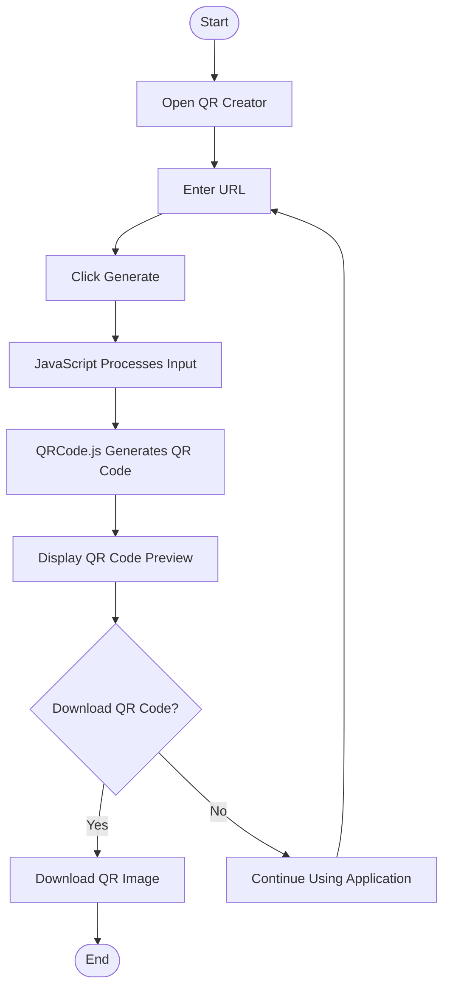

# QR Creator

A simple and lightweight web-based QR Code Generator that converts URLs into QR codes instantly. Generate, preview, and download QR codes through a clean and easy-to-use interface.

## Overview

QR Creator makes sharing links easier by converting URLs into scannable QR codes. Instead of sharing long links, users can generate a QR code and share it with anyone.

## Features

- Generate QR codes from URLs.
- Simple and user-friendly interface.
- Instant QR code generation.
- Preview generated QR codes.
- Download QR codes for future use.
- Browser-based application.

## Technology Stack

| Technology | Purpose |
|---|---|
| HTML5 | Application structure |
| CSS3 | Styling and layout |
| JavaScript | Application logic |
| QRCode.js | QR code generation |

## Project Structure

```text
QR-creator/
│
├── assests/
│   ├── css/
│   │   └── style.css
│   │
│   └── js/
│       └── app.js
│
├── libs/
│
├── index.html
├── robots.txt
├── sitemap.xml
├── googlec57b8911eec10df7.html
└── README.md
```

## Application Workflow



## Getting Started

### Prerequisites

- A modern web browser.
- Git installed on your system.
- Internet connection if the QRCode.js library is loaded through a CDN.

### Installation

**1. Clone the repository**

```bash
git clone https://github.com/Nish-D-git/QR-creator.git
```

**2. Navigate to the project directory**

```bash
cd QR-creator
```

**3. Run the application**

Open `index.html` in your preferred browser.

Alternatively, use the Live Server extension in Visual Studio Code.

## Use Cases

- Sharing website URLs.
- Sharing social media profiles.
- Creating QR codes for business links.
- Sharing educational resources.
- Quick access to online content.

## Future Improvements

- Support for plain text and contact information.
- Custom QR code colors.
- Multiple download formats.
- Responsive design improvements.

## Developer

**Nishant Deshmukh**

GitHub: [Nish-D-git](https://github.com/Nish-D-git)

Project Repository: [QR Creator](https://github.com/Nish-D-git/QR-creator)

---

If you find this project useful, consider giving the repository a star.

**Built with HTML, CSS and JavaScript.**
